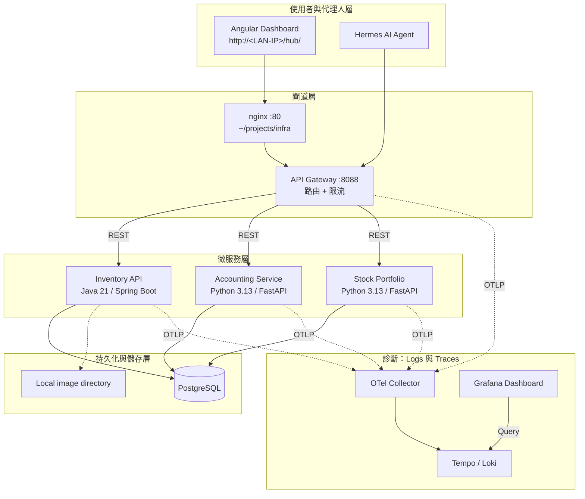

# 🏠 Home Service Hub (家庭服務中樞)

這是一個實際使用中的 **個人生活運算中樞**。系統由前端與多個 API 服務組成，另以 AI agent 呼叫記帳 API；架構以家用、單機部署的可靠性與可維護性為優先。

## 🏗 系統架構 (Architecture)

### 入口與閘道的分工

- **nginx（唯一 LAN 入口）**：定義於相鄰 repo `~/projects/infra`，以純 HTTP 提供首頁 `http://<LAN-IP>/` 與 Angular 應用 `http://<LAN-IP>/hub/`（直接服務 `frontend/dist`），並將 `/api/*`、`/images/inventory-items/*` 轉發到 `127.0.0.1:8088` 的 Gateway。
- **API Gateway（路由與限流）**：所有 API 請求的單一入口，依路徑前綴路由到後端並以 bucket4j 限流。
- **後端服務**：僅綁定 `127.0.0.1`。系統不含登入與 token 驗證，存取邊界依賴 LAN/VPN。

## 🌟 亮點功能 (Features)

- **🤖 Agent 記帳**: Hermes agent 透過閘道呼叫記帳 API。
- **🚪 統一入口與閘道**: nginx 為唯一 LAN 入口，Spring Cloud Gateway 集中路由並限流；無登入流程。
- **可追查的 Logs 與 Traces**: OpenTelemetry 將服務日誌送至 Loki、trace 送至 Tempo，再由 Grafana 統一查閱；用於除錯與追查跨服務流程，而不是收集所有 request body。
- **Python Logs 與 Traces**: Python 服務以標準 `logging` 搭配 OpenTelemetry 輸出日誌；FastAPI trace 只保留 request root span，省略 ASGI `send` / `receive` 細節與 `/health`，讓 Grafana 的結構更接近應用流程。
- **Streamer DVR operations**: `~/projects/infra` 的 Compose 以 read-only 方式將 `../streamer-rec/streamer-dvr/logs/`（可用 `STREAMER_DVR_LOG_DIR` 覆寫）掛載給 OTel Collector。Collector 解析其中的 JSONL 業務事件後送入 Loki；Grafana 的 `Streamer DVR · Operations` 位於獨立 folder，SQLite 與 Streamer DVR Vue Logs 頁面不受影響。
- **AI 驅動記帳系統**: Agent 先解析自然語言輸入，再呼叫 Accounting API 建立財務交易。
- **智慧庫存與投資**: 整合物件儲存（本機圖片目錄）管理實體物資，並自動抓取即時台股數據；台股組合支援 CSV 匯入、每日 OHLC 回填、除權息事件抓取、減資/分割自動調整成本基礎，以及當沖標記推導。
- **In-process Scheduler**: 台股組合服務內建 APScheduler，每日 17:00 回補 TWSE/TPEx 收盤、盤中每 15 分鐘刷新報價、15:30 寫入淨值快照。可透過 `SCHEDULER_ENABLED=false` 關閉。

## 🚀 快速開始 (Getting Started)

### 1. 環境準備
- **配置環境變數**: `cp .env.example .env`，再替換其中的密碼與固定 LAN IP；請勿直接使用範例 placeholder。
- **啟動基礎設施**: `docker compose up -d`。Compose 只管理 PostgreSQL；應用服務由下方命令或 PM2 啟動。
- **啟動 nginx 入口與觀測性元件**: 於 `~/projects/infra` 執行 `docker compose up -d`（nginx、OTel Collector、Tempo、Loki、Grafana，與 streamer-rec 共用）。

### 2. 啟動服務 (各服務目錄下執行)
- **Inventory**: `./gradlew :item-service:bootRun`
- **Accounting**: `uvicorn app.main:app --port 8000`
- **Stock**: `uvicorn app.main:app --port 8001`
- **Gateway**: `../inventory-api/gradlew -p . bootRun`（於 `services/gateway-service`）
- **Frontend（LAN）**: `npm run build`，nginx 直接服務 `frontend/dist`，無需重啟；入口 `http://<LAN-IP>/hub/`
- **Frontend（本機開發）**: `npm start`（`http://localhost:4200`，僅限本機，無 SSL，不由 PM2 啟動）

或一次啟動全部：`npx pm2 start ecosystem.config.js`

> 入口網址已改為 `http://<LAN-IP>/hub/`；iPhone 主畫面圖示需從新網址重新加入。

### 3. Stock Portfolio 服務環境變數
- `SCHEDULER_ENABLED` (預設 `true`)：設 `false` 停用內建 APScheduler（測試 / CI 必設）。

服務細節（端點清單、Scheduler cron、Day-trade 推導規則等）見 [`services/stock-portfolio-service/README.md`](services/stock-portfolio-service/README.md)。

### 4. 本機安全預設

- Compose 發佈的基礎設施服務預設只綁定 loopback。`INFRA_BIND_HOST` 控制 PostgreSQL；OTel、Tempo、Loki 由 `~/projects/infra` 同樣只綁 loopback。後端服務由 PM2 啟動並只綁定 `127.0.0.1`。
- Grafana 只綁 `127.0.0.1:3000`；區網／VPN 一律經 nginx 的 `http://<LAN-IP>/grafana/` 進入。
- PM2 啟動的 Accounting、Stock backends 與 Gateway 都只綁定 `127.0.0.1`；nginx（`~/projects/infra`）維持 VPN/LAN 可達，作為唯一瀏覽器入口，API 流量經其反向代理進入 Gateway。
- Inventory 在本機直接啟動時由 `INVENTORY_SERVER_ADDRESS` 控制監聽位址，預設 `127.0.0.1`。
- Inventory 的 OpenAPI 與 Swagger UI 預設關閉；維護端點或要提供 API 清單給 agent 時，設 `INVENTORY_API_DOCS_ENABLED=true`，再從 `/v3/api-docs` 匯出 `api.json`。只在受信任環境短暫開啟。
- SQL query text、parameter values 與 query arguments 預設不進入觀測資料。除錯時可分別使用 `INVENTORY_SQL_QUERY_TEXT_ENABLED`、`INVENTORY_SQL_PARAMETER_VALUES_ENABLED`、`INVENTORY_SQL_QUERY_ARGUMENTS_ENABLED` 顯式開啟；Hibernate SQL logger 另由 `INVENTORY_HIBERNATE_SQL_LOG_LEVEL` 控制，預設 `OFF`。這些內容可能包含敏感資料。
- HTTP query string 與 request payload logging 預設關閉。僅在受信任的短期除錯環境分別使用 `INVENTORY_HTTP_QUERY_LOGGING_ENABLED=true` 或 `INVENTORY_HTTP_PAYLOAD_LOGGING_ENABLED=true`；完成後應立即恢復安全預設。
- `INVENTORY_IMAGE_STORAGE_DIR` 是 Inventory 寫入圖片的本機目錄。瀏覽器以同源路徑 `/images/inventory-items/**` 存取圖片，由 nginx 轉到 Gateway，再轉到 inventory-api 的 `/inventory-items/**`。
- `.env.example` 只提供 placeholder。請在未納入版本控制的 `.env` 中自行設定實際密碼；修改 template 不會輪替現有 PostgreSQL 或 Grafana 帳密。

## 🗺 發展路線 (Roadmap)

### 🟡 Phase 1 & 2: 核心強化與認證 (Active)
- [x] **移除認證（2026-11）**: Keycloak/OIDC/JWT 已全面移除，改由 nginx 作為單一 LAN 入口；設計見 `docs/superpowers/specs/2026-11-19-remove-keycloak-design.md`。
- [ ] **Python 觀測性優化**: 完善 Python 服務的 Trace 欄位與 Context 傳遞。
- [x] **後端精細化驗證**: `jakarta.validation` 已用於 Java 端 DTO 與 Controller 驗證。
- [x] **庫存圖片儲存**: 圖片上傳已實作。物件存本機目錄，瀏覽器走同源 `/images` 路徑；縮圖由前端上傳前壓縮。

### 🟣 Phase 3: 跨服務業務整合 (Planned)
- [ ] **投資與記帳串接**: 將投資交易產生的現金流與既有記帳規則串接；第一版採同步 API，讓使用者能立即看見成功或失敗。
- [ ] **可追查的業務鏈**: 上述跨服務流程實作時，補齊 Gateway 到後端的 trace propagation，並在 Grafana 建立對應的操作視圖。

### 🔴 Phase 4: 依需求演進 (Planned)
- [x] **API Gateway & Rate Limiting**: Spring Cloud Gateway 統一入口（路由 + bucket4j 限流）。
- [ ] **背景工作與共享快取**: 僅在出現不可接受的等待時間、可靠重試或多實例一致性需求時，再以具體流程評估 queue 或 distributed cache。

---
*Created and maintained as a personal digital life management suite.*

## 📄 授權 (License)

本專案採用 [MIT](LICENSE) 授權。您可以自由使用、修改與分發，但請保留原作者版權聲明。
